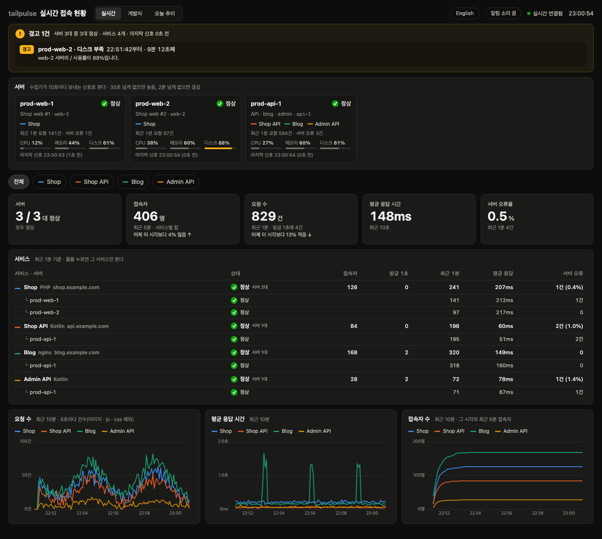
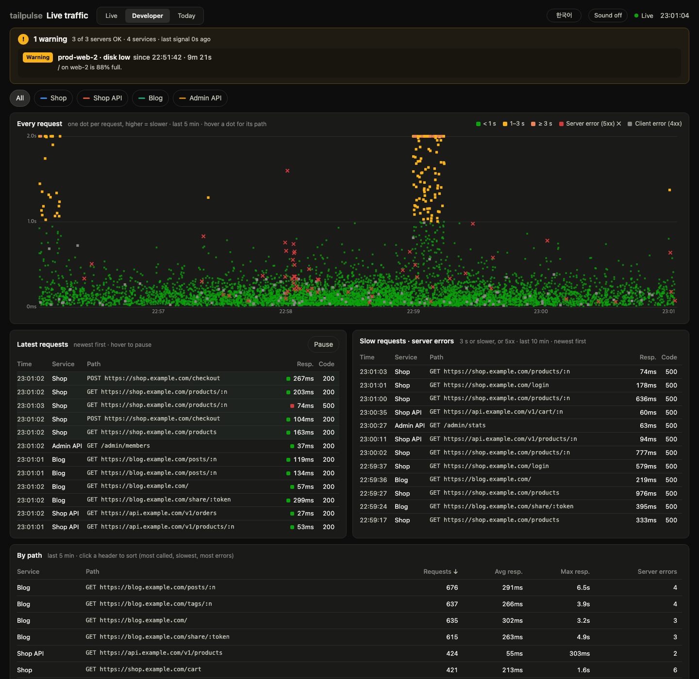
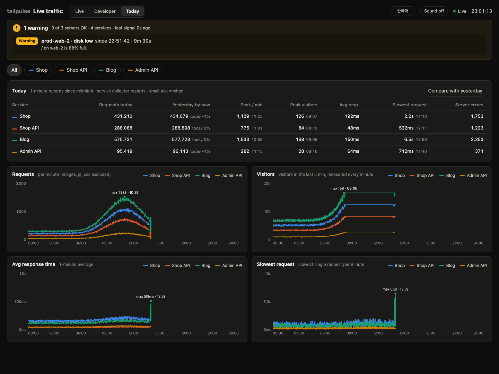

# tailpulse

**웹서버 접속 로그를 읽어 보여 주는, 작고 직접 운영하는 실시간 접속 현황 도구.**
SDK도, 코드 수정도, 데이터베이스도, 외부 SaaS도 없습니다. 서버마다 파이썬 파일 하나, 화면은 jar 하나.

[English README](README.md)



- **지금 사이트가 살아 있나?** 서버마다 수집기가 10초마다 신호를 보냅니다. 신호가 끊기면 2분 안에 맨 위 상태 줄이 빨갛게 바뀌고, 그 서버가 맡던 서비스를 다른 서버가 계속 받는지까지 알려 줍니다.
- **요청이 얼마나, 얼마나 빨리, 오류는?** 서비스별 초당 요청 · 접속자 · 응답 시간 · 5xx 비율을 1초마다(Server-Sent Events) 갱신합니다.
- **정확히 무엇이 느린가?** 요청 한 건 한 건을 점으로, 방금 들어온 요청, 느린 요청 · 서버 오류, 주소별 표.
- **오늘은 평소와 같은가?** 오늘 하루 1분 단위 기록과 어제 겹쳐 보기, 7일 보관.
- **슬랙 알림:** 수집기 신호 끊김, 5xx 급증, 갑자기 요청이 끊김, 디스크 부족, 메모리 부족.
- **개인정보 보호:** 쿼리 문자열은 버리고, 주소 속 번호 · 토큰은 가리고, IP는 서버 밖으로 나가지 않습니다(접속자는 날마다 바뀌는 해시로만 셉니다).
- 화면은 **한국어 · 영어**(오른쪽 위 버튼, 또는 `?lang=ko` / `?lang=en`).

## 누구에게 맞나

서버 몇 대(PHP, Java/Kotlin, Node 등 nginx · Apache 뒤의 무엇이든)를 운영하면서 "지금 다 괜찮은가?"를 보여 줄 화면과 알림이 **오늘 당장** 필요한 작은 팀. 정식 APM을 들이거나, 언어별 에이전트를 깔거나, 접속 데이터를 외부로 보내고 싶지 않을 때 맞습니다. 손대기 싫은 오래된 서버에 특히 좋습니다: 수집기는 파이썬 3.6 표준 라이브러리만으로 돌고, 웹서버 · 앱은 전혀 건드리지 않습니다.

### 상용 APM과 비교

| | tailpulse | 상용 APM (Datadog, New Relic 등) |
|---|---|---|
| 설치 | 파이썬 파일 하나 + 설정 복사, 로그 형식 변경, `docker compose up` | 앱마다 언어 에이전트 · SDK, 코드나 실행 옵션 변경이 필요할 때가 많음 |
| 데이터가 가는 곳 | 내 서버뿐 | 업체 클라우드 |
| 비용 | 무료(MIT) | 서버 수 · 데이터 양에 따라 과금 |
| 오래된 환경(PHP 5, 파이썬 3.6 서버) | 로그만 읽으므로 동작 | 지원하지 않을 때가 많음 |
| 화면 지연 | 약 1초 | 보통 10초~1분 |
| 분산 추적, DB 쿼리 시간, 오류 스택 | **없음** | 있음 |
| 실사용자 모니터링(RUM), 로그 검색, 대시보드 편집 | **없음** | 있음 |
| 고가용성, 장기 보관 | **없음**(아래 한계) | 있음 |

### 한계 (일부러 이렇게 만들었습니다)

- **단일 인스턴스.** 수집 서버 프로세스 하나가 모든 것을 들고 있습니다. 클러스터 · 이중화가 없어서, 꺼지면 모니터링도 멈춥니다([자체 감시](#자체-감시-watchdog)를 쓰세요).
- **요청 한 건 기록은 메모리에만** 둡니다 — 최근 30분, 서비스당 최대 20만 건. 다시 켜면 비워집니다.
- **DB 없음.** 1분 집계(건수, 응답 시간 합 · 최대, 접속자 수)만 작은 JSONL 파일로 남기고 7일 보관합니다.
- 접속 로그에 있는 것만 봅니다: 메서드, 주소, 상태 코드, 응답 시간. 앱 내부에서 무슨 일이 있었는지는 모릅니다.
- 수집기는 CPU · 메모리를 `/proc`에서 읽으므로 리눅스용입니다. 알림은 슬랙 Incoming Webhook만. 화면 로그인은 공용 비밀번호 하나(HTTP Basic)입니다.
- 수집 서버 하나에 서비스 30개까지.

## 동작 방식

```
 각 서버                                             수집 서버 (jar 하나)                          브라우저
┌───────────────────────────┐                     ┌──────────────────────────────┐            ┌──────────────┐
│ nginx / apache 접속 로그  │                     │ tailpulse (Spring Boot)      │            │ 화면         │
│            │ tail         │  POST /ingest       │  · 최근 30분은 메모리        │  SSE       │ (순수        │
│            ▼              │  X-Tailpulse-Token  │  · 1분 집계 → 파일           │ /api/stream│  HTML/JS/CSS)│
│ tailpulse_agent.py ───────┼────────────────────▶│  · 알림 → 슬랙               ├───────────▶│ 1초마다 갱신 │
│ (10초마다 심장 신호,      │  JSON 묶음          │                              │            │              │
│  CPU · 메모리 · 디스크)   │                     └──────────────────────────────┘            └──────────────┘
└───────────────────────────┘
```

1. **수집기**는 접속 로그를 따라 읽고(logrotate의 파일 교체 · copytruncate 모두 따라감), 한 줄을 작은 이벤트로 바꿔 주소를 가리고 방문자를 해시한 뒤, `X-Tailpulse-Token` 헤더를 붙여 `/ingest`로 묶어 보냅니다. 요청이 없어도 10초마다 빈 묶음을 보내는데, 이것이 심장 신호이고 CPU · 메모리 · 디스크 사용률도 함께 실립니다.
2. **수집 서버**는 최근 30분을 메모리에 두고 초 단위 통계를 내며, 서비스별 1분 집계를 한 줄씩 파일에 쓰고, 알림 조건을 봅니다.
3. **화면**은 처음에 스냅숏을 받고, 그 뒤로 Server-Sent Events로 1초마다 갱신을 받습니다.

## 빠른 시작 (데모)

Docker가 필요합니다.

```sh
git clone https://github.com/chonghg22/tailpulse.git
cd tailpulse
docker compose up --build
```

<http://localhost:8080?lang=ko>를 엽니다. 데모는 서버 3대 · 서비스 4개짜리 예시 설정으로 수집 서버를 띄우고, **오늘 추이** 탭이 비어 있지 않도록 어제 · 오늘 기록을 미리 만들고, 가짜 요청을 계속 보냅니다. 해 볼 것:

- `DEMO_DOWN=web-2 docker compose up` — 웹 서버 한 대가 "죽습니다". 2분 뒤 상태 줄이 빨갛게 바뀌고, 쇼핑몰은 web-1이 계속 받고 있다고 보여 줍니다.
- **개발자** 탭: 점에 마우스를 올리고, 주소별 표 제목을 눌러 정렬해 보세요.
- `docker compose down -v`로 데모 데이터를 지웁니다.
- 한국 시간으로 하루를 나누려면 `TZ=Asia/Seoul`을 앞에 붙입니다.

Docker 없이(JDK 21, 파이썬 3): `./dev demo`.

| 개발자 탭 | 오늘 추이 탭 |
|---|---|
|  |  |

## 실제로 쓰기

### 1. 수집 서버 띄우기

모든 수집기가 닿을 수 있는 서버(사설 주소가 가장 좋습니다)를 고릅니다. 토큰과, 화면을 밖에서 볼 거라면 비밀번호를 만듭니다.

```sh
openssl rand -hex 32   # 수집 토큰: 수집기가 보내고 수집 서버가 확인
openssl rand -hex 16   # 화면 비밀번호
```

**Docker로**

```sh
mkdir -p config && cp deploy/application.example.yaml config/application.yaml   # 서비스 · 서버 목록 수정
cp deploy/tailpulse.env.example tailpulse.env && chmod 600 tailpulse.env         # 토큰 · 비밀번호 입력
docker compose -f deploy/docker-compose.prod.yml up -d --build
```

**Docker 없이**(Java 21): `./gradlew bootJar`로 `build/libs/tailpulse.jar`를 만들고, [`deploy/systemd/tailpulse.service`](deploy/systemd/tailpulse.service)로 설치합니다(순서는 그 파일 맨 위에 있습니다). Spring Boot가 작업 폴더의 `config/application.yaml`을 읽습니다.

확인: `curl http://<수집 서버>:8080/healthz` → `{"ok":true,"status":"UP"}`.

### 2. 서버마다 수집기 설치

필요한 것: systemd가 있는 리눅스, 파이썬 3.6 이상(표준 라이브러리만), 접속 로그 읽기 권한.

다음 파일을 서버의 한 폴더에 올립니다.

```
agent/tailpulse_agent.py
agent/tailpulse-agent.service
agent/install-agent.sh
config.json          # agent/config.example.json 을 고친 것
token                # 수집 토큰이 한 줄 든 파일
```

그리고:

```sh
sudo bash install-agent.sh install config.json token
# adm 그룹이 없는 배포판(RHEL, 아마존 리눅스)이라면 로그를 읽을 수 있는 그룹을 줍니다
sudo bash install-agent.sh install config.json token --group nginx
```

설치 스크립트는 `tailpulse` 시스템 계정을 만들고, 파일을 `/usr/local/lib/tailpulse-agent`, `/etc/tailpulse-agent`에 놓고(토큰은 600), **그 계정으로 먼저 `--check`를 돌려** 로그가 해석될 때만 서비스를 켭니다. 다시 시작하는 것은 `tailpulse-agent`뿐이고 웹서버는 건드리지 않습니다. 메모리 80MB · CPU 10%로 제한됩니다. 갱신도 같은 명령입니다.

```sh
sudo bash install-agent.sh status      # 상태 · 버전 · 메모리
sudo bash install-agent.sh check       # 최근 200줄 해석률(전송 없음)
sudo bash install-agent.sh uninstall
python3 tailpulse_agent.py --config config.json --dry-run   # 보낼 내용만 화면에
```

`--check`는 최근 200줄 중 형식이 맞는 줄, 보낼 요청, 상태 확인 등으로 건너뛴 줄, 응답 시간이 있는 줄, 서로 다른 방문자 수를 보여 줍니다. `TAILPULSE_LANG=ko`면 한국어로 나옵니다.

> 수집 서버 설정의 `hosts`에는 수집기 연결을 확인한 **뒤에** 서버 이름을 적습니다. 먼저 적으면 곧바로 "신호 없음" 알림이 옵니다.

### 수집기 설정

```json
{
  "collector": "http://192.0.2.10:8080/ingest",
  "token_file": "/etc/tailpulse-agent/token",
  "host": "web-1",
  "disks": ["/", "/data"],
  "sources": [
    { "service": "shop-web", "path": "/var/log/nginx/access.log", "format": "timed", "rt_unit": "s" },
    { "service": "shop-api", "path": "/var/log/nginx/api.access.log", "format": "timed", "rt_unit": "s",
      "exclude_path": "^/actuator/" }
  ],
  "alive": [ { "service": "ws", "url": "http://127.0.0.1:3000/" } ]
}
```

| 항목 | 뜻 |
|---|---|
| `collector` | 수집 서버의 `/ingest` 주소 |
| `token_file` | 수집 토큰 파일 |
| `host` | 화면에 보일 서버 이름(`[a-z0-9_-]`, 40자 이내). 기본은 호스트 이름 |
| `disks` | 사용률을 보낼 마운트 경로. 기본 `["/"]` |
| `sources[].service` | 서비스 이름. 수집 서버의 `services[].name`과 같아야 합니다 |
| `sources[].path` | 로그 파일. 날마다 이름이 바뀌는 로그는 `strftime` 틀(`/logs/access.%Y-%m-%d.log`)을 쓸 수 있고, `path_tz_offset_hours`로 날짜를 옮깁니다(서버 시계는 UTC인데 파일 이름은 한국 날짜면 `9`) |
| `sources[].format` | `combined`, `combined_rt`, `timed`(권장), `json` — 아래 참고 |
| `sources[].rt_unit` | 로그의 응답 시간 단위: `s`(nginx), `us`(apache `%D`), `ms` |
| `sources[].regex` | 형식 대신 직접 쓰는 정규식. 그룹 이름: `ip`, `xff`, `ua`, `method`, `path`, `status`, `rt`(+ `require`에 쓰는 것) |
| `sources[].json_keys` | `json` 형식의 항목 이름. 예: `{"path": "uri", "rt": "duration"}` |
| `sources[].require` | 그룹 값이 맞는 줄만 보냄. 예: `{"vhost": "^www\\.example\\.com$"}`, `{"path": "^/admin(/\|$)"}` |
| `sources[].exclude_path` | 이 주소는 보내지 않음(가린 뒤의 주소에 정규식). 예: `^/cron$`, `^/actuator/` |
| `alive[]` | 접속 로그가 없는 서비스. 아래 참고 |

늘 빼는 것: `HEAD` · `OPTIONS`, 로드밸런서 상태 확인(`ELB-HealthChecker`), `Blackbox Exporter`, tailpulse 자신의 확인 요청.

### 웹서버 로그 형식

기본 `combined` 형식 그대로도 됩니다(요청 수 · 접속자 · 오류). 다만 **응답 시간이 없습니다.** 줄 끝에 응답 시간과 `X-Forwarded-For` 두 항목을 덧붙이고 `"format": "timed"`를 쓰세요. reload만 하면 되고, 줄 앞부분은 `combined` 그대로라 다른 로그 도구도 계속 읽을 수 있습니다.

**nginx** (`http {}` 안):

```nginx
log_format tailpulse '$remote_addr - $remote_user [$time_local] "$request" '
                     '$status $body_bytes_sent "$http_referer" "$http_user_agent" '
                     'rt=$request_time xff="$http_x_forwarded_for"';
access_log /var/log/nginx/access.log tailpulse;
```

→ 수집기: `"format": "timed", "rt_unit": "s"`, 그리고 `sudo nginx -t && sudo nginx -s reload`.

**Apache** (`conf-available/tailpulse.conf`, `a2enconf tailpulse`):

```apache
LogFormat "%h %l %u %t \"%r\" %>s %b \"%{Referer}i\" \"%{User-Agent}i\" rt=%D xff=\"%{X-Forwarded-For}i\"" tailpulse
CustomLog ${APACHE_LOG_DIR}/access.log tailpulse
```

→ 수집기: `"format": "timed", "rt_unit": "us"`(`%D`는 마이크로초), 그리고 `sudo apachectl -t && sudo systemctl reload apache2`.

| `format` | 로그 | 응답 시간 |
|---|---|---|
| `combined` | nginx · Apache 기본 | 없음 |
| `combined_rt` | combined 맨 끝에 응답 시간 | 있음 |
| `timed` | combined + `rt=… xff="…"`(위) | 있음 |
| `json` | 한 줄에 JSON 하나(기본 항목: `remote_addr`, `request_method`, `request_uri`, `status`, `request_time`, `http_user_agent`, `http_x_forwarded_for`) | 있음 |

**로드밸런서 · 프록시 뒤**라면 `$remote_addr`가 프록시 주소라서 모든 요청이 한 사람처럼 보입니다. 로그에 `xff`가 있으면 수집기는 `X-Forwarded-For`에서 **오른쪽부터 사설 주소가 아닌 첫 값**을 실제 접속자로 씁니다(맨 앞 값은 브라우저가 마음대로 넣을 수 있어 믿지 않습니다). 공인 주소를 쓰는 CDN이 앞에 있다면 nginx `real_ip`(또는 Apache `mod_remoteip`)로 `$remote_addr`가 실제 접속자가 되게 설정하세요.

### 접속 로그가 없는 서비스 (`alive`)

웹소켓 서버, 상태 확인 주소만 있는 워커처럼 접속 로그를 남기지 않는 앱:

```json
"alive": [ { "service": "ws", "url": "http://127.0.0.1:3000/", "timeout_sec": 3 } ]
```

수집기가 10초마다 **같은 서버 안의** 주소를 부릅니다. 제한 시간 안에 500 미만 응답이 오면(404도 앱이 응답한 것) 살아 있는 것으로 보고 그때만 신호를 보냅니다. 응답이 없으면 신호를 멈추므로 화면과 슬랙에서 그 서버가 끊김으로 보입니다. `sources`는 비워도 됩니다.

## 수집 서버 설정

환경 변수(비밀값) — [`deploy/tailpulse.env.example`](deploy/tailpulse.env.example):

| 변수 | 기본 | 뜻 |
|---|---|---|
| `TAILPULSE_INGEST_TOKEN` | *(빈 값)* | 수집기가 보내야 하는 토큰. **비어 있으면 `/ingest`를 모두 거부** |
| `TAILPULSE_VIEW_PASSWORD` | *(빈 값)* | 화면 · API 비밀번호(HTTP Basic, 아이디는 아무 값). 비어 있으면 로그인 없이 열림: localhost · 사설망에서만 |
| `TAILPULSE_SLACK_WEBHOOK_FILE` | *(빈 값)* | 슬랙 Incoming Webhook 주소가 든 파일. 비어 있으면 슬랙 알림 없음(화면에는 보임) |
| `TAILPULSE_LANG` | `en` | 슬랙 알림 언어: `en` 또는 `ko` |
| `TAILPULSE_ZONE` | 서버 시간대 | 오늘 추이의 하루 기준. 예: `Asia/Seoul` |
| `TAILPULSE_DATA_DIR` | `data` | 1분 집계 파일 폴더(`trend/trend-YYYY-MM-DD.jsonl`) |
| `TAILPULSE_PORT` | `8080` | HTTP 포트 |

`config/application.yaml` — [`deploy/application.example.yaml`](deploy/application.example.yaml):

```yaml
tailpulse:
  services:
    - name: shop-web                   # = 수집기가 보내는 service
      label: 쇼핑몰                     # 화면에 보일 이름
      kind: PHP                        # 표시용 꼬리표
      url: https://shop.example.com    # 주소 앞에 붙여 보여 줌(호출하지 않음)
      health-url: https://shop.example.com/   # 선택: 10초마다 접속, 5xx · 5초 초과 · 연결 실패면 응답 없음
      hosts: [web-1, web-2]            # 선택: 한 번도 신호가 없어도 알림
  host-info:                           # 수집기 host → 서버 카드 · 알림에 보일 이름과 하는 일
    web-1: { name: "prod-web-1", role: "쇼핑몰 웹 1번" }
```

목록에 없는 서비스도 수집기가 보내면 화면에 나옵니다(이름 그대로).

### 알림

화면 맨 위 빨강 · 노랑 상태 줄과 슬랙 알림은 같은 기준을 씁니다. 같은 문제는 한 번만 보내고, 풀리면 복구를 한 번 보냅니다.

| 알림 | 기준(기본값) | 설정 |
|---|---|---|
| 수집 끊김 | 신호가 120초 넘게 없음(`hosts`에 적은 서버는 한 번도 안 왔을 때도) | `agent-silent-seconds` |
| 서버 오류 급증 | 최근 1분 5xx가 10건 이상 **이면서** 20% 이상 | `error-surge-count`, `error-surge-percent` |
| 요청 끊김 | 직전 10분에 분당 20건 이상 들어오다 3분째 0건(서버는 켜져 있는데 사이트만 죽은 경우) | `silence-min-per-minute` |
| 디스크 | 85% 경고, 95% 긴급 | `disk-warn-percent`, `disk-critical-percent` |
| 메모리 | 90% 이상이 10분 넘게 | `memory-warn-percent` |
| 사이트 응답 없음 | `health-url`이 60초 넘게 실패 | `health-down-seconds` |

슬랙 연결 확인: `curl -u x:<비밀번호> -X POST http://localhost:8080/api/alert-test`.

화면의 **알림 소리** 버튼을 켜면 새 장애가 생길 때 소리와 브라우저 알림이 함께 옵니다(켠 브라우저에서만).

### 주소 목록

| | |
|---|---|
| `POST /ingest` | 수집기 묶음(토큰 헤더, 한 번에 2,000건까지) |
| `GET /api/snapshot` | 지금 상태와 최근 10분 |
| `GET /api/stream` | Server-Sent Events, 1초마다 `tick` |
| `GET /api/trend?date=YYYY-MM-DD` | 그날 1분 집계(생략하면 오늘) |
| `POST /api/alert-test` | 슬랙 시험 알림 |
| `GET /healthz` | `{"status":"UP"}`, 비밀번호 없음 |

## 보안 · 개인정보

**수집기가 보내는 것**(요청마다): 시각, 응답 시간, 상태 코드, 메서드, 주소(가린 것), 방문자 해시, 정적 파일 여부. 묶음마다: 서비스, 서버 이름, 그리고 10초마다 CPU · 메모리 · 디스크 사용률과 부하.

**절대 보내지도 저장하지도 않는 것:** IP 주소, User-Agent 원문, 쿼리 문자열, 요청 · 응답 본문, 쿠키, 헤더, 가리지 않은 주소 속 번호 · 토큰.

- 주소: 쿼리 문자열(`?…`)과 `#` 뒤를 떼고, 숫자만 있는 자리는 `:n`, 토큰처럼 보이는 자리(URL에 쓰는 문자 20자 이상, 또는 16진수 16자 이상)는 `:token`으로 바꾸고, 120자에서 자릅니다. 가리는 규칙은 추정이므로 `--dry-run`으로 실제 주소를 확인하고, 놓치는 민감한 주소(예: 주소에 든 이메일)는 `exclude_path`로 빼세요.
- 방문자: `sha256(토큰 + 날짜 + IP + User-Agent)`의 앞 16자. 날마다 바뀌어 날을 넘겨 같은 사람을 따라갈 수 없습니다. 다만 **익명이 아니라 가명**입니다: 토큰을 아는 사람은 대입해 볼 수 있으니 토큰을 비밀로 지키세요.
- 수집 서버에서 요청 한 건 기록(가린 주소, 해시)은 **메모리에 30분만** 있습니다. 파일에는 분당 건수 · 응답 시간 합 · 최대 · 접속자 수만 남고(주소 · 해시 없음) 7일 뒤 지워집니다.

**권고**

- 수집 서버의 `/ingest` 포트는 **수집기를 단 서버의 IP에만** 여세요(보안 그룹 · 방화벽). 가장 좋은 것은 수집기가 수집 서버의 사설 주소로 보내는 것입니다. 인터넷으로만 닿는 서버가 있다면 리버스 프록시로 `/ingest`를 열고 그 서버 IP만 허용하세요 — [`deploy/nginx-tailpulse.conf`](deploy/nginx-tailpulse.conf).
- 화면은 HTTPS 뒤에 두고(위 예시), `TAILPULSE_VIEW_PASSWORD`를 설정하고, 필요하면 사무실 · VPN 주소로만 제한하세요. 예시에는 비밀번호 대입을 늦추는 요청 제한도 들어 있습니다.
- `tailpulse.env`, 토큰 파일, 웹훅 파일은 600 권한으로 둡니다. 웹훅 주소는 로그에 남지 않습니다.
- 데모 프로필은 공개된 토큰(`demo-token`)을 쓰고 `127.0.0.1`에만 열립니다. 밖으로 열지 마세요.

## 자체 감시 (watchdog)

tailpulse가 죽으면 알림도 같이 멈춥니다. [`deploy/watchdog/tailpulse-watchdog.sh`](deploy/watchdog/tailpulse-watchdog.sh)를 **다른** 서버에서 cron으로 1분마다 돌리면 `/healthz`를 보고, 3번 연속 실패하면 슬랙에 한 번, 풀리면 복구를 한 번 보냅니다. 그 서버에도 tailpulse 수집기를 달아 두면 서로 감시하게 됩니다.

```sh
echo 'https://hooks.slack.com/services/...' > webhook && chmod 600 webhook
sudo bash tailpulse-watchdog.sh install --url https://monitor.example.com/healthz --webhook-file webhook --lang ko [--fails 3]
rm webhook
sudo tailpulse-watchdog status          # 상태와 최근 기록(/var/log/tailpulse-watchdog.log)
# 슬랙 없이 시험:
DRY_RUN=1 URL=http://127.0.0.1:1/healthz STATE_DIR=/tmp/wd CONF_DIR=/tmp/wd bash tailpulse-watchdog.sh
```

`bash`, `curl`, `python3`가 필요합니다. 웹훅 주소는 표준 입력으로 curl에 넘기므로 `ps`나 로그에 나타나지 않습니다.

## 개발

```sh
./gradlew test                                  # 수집 서버(Kotlin, JUnit)
python3 -m unittest discover -s agent/tests     # 수집기(CI에서는 파이썬 3.6에서도 돌립니다)
./dev demo                                      # 수집 서버 + 가짜 요청, http://localhost:8080
```

- 수집 서버: Kotlin, Spring Boot, Java 21(`src/main/kotlin`). 화면: 라이브러리 · CDN 없는 순수 HTML/JS/CSS(`src/main/resources/static`). 화면 문구는 `app.js` 맨 위 `I18N` 표에 있습니다.
- 수집기는 파이썬 3.6 표준 라이브러리만 쓰는 파일 하나로 유지합니다. 로그는 읽기만 하고, 수집 서버에 닿지 않으면 서버에 영향을 주지 않도록 조용히 버립니다.

## 라이선스

[MIT](LICENSE)
