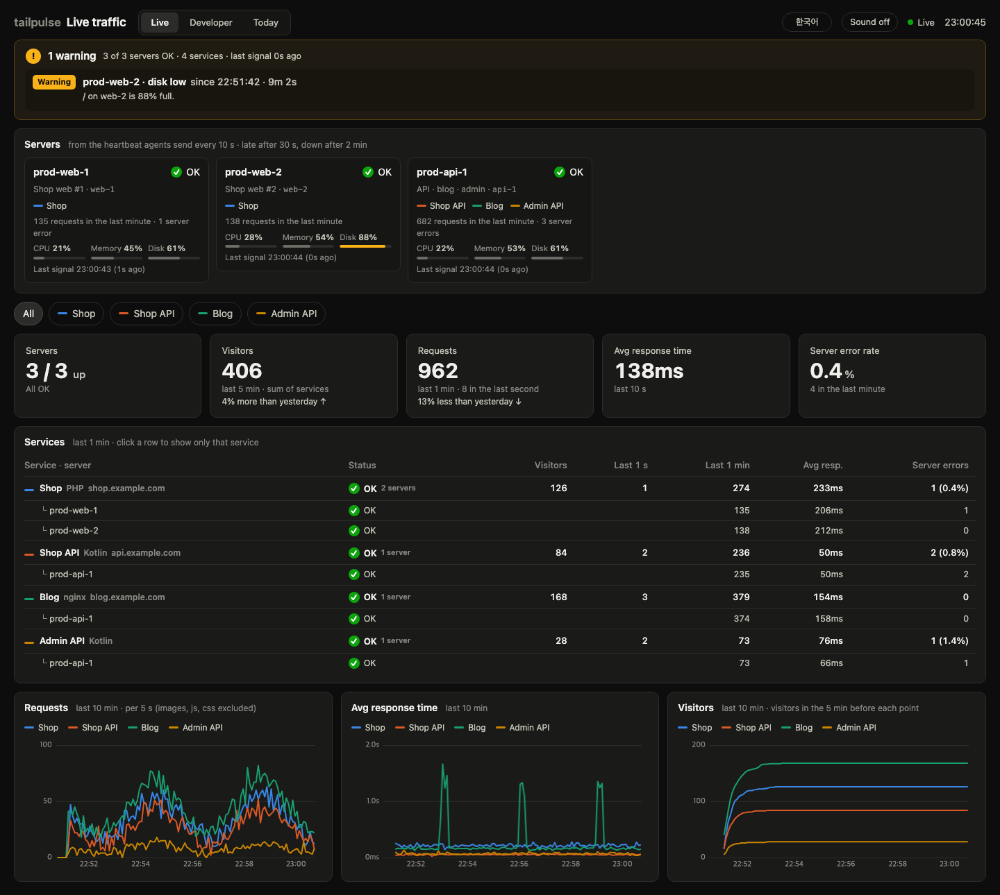
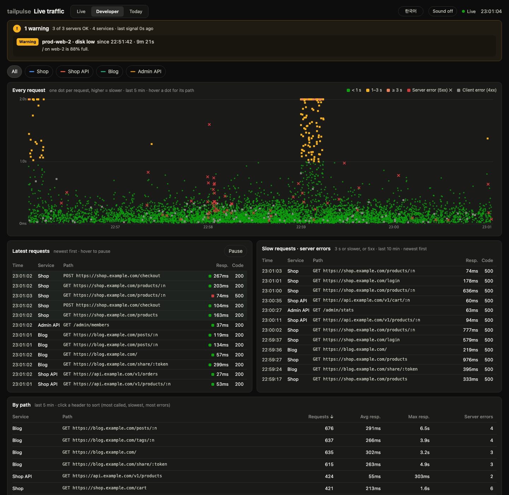
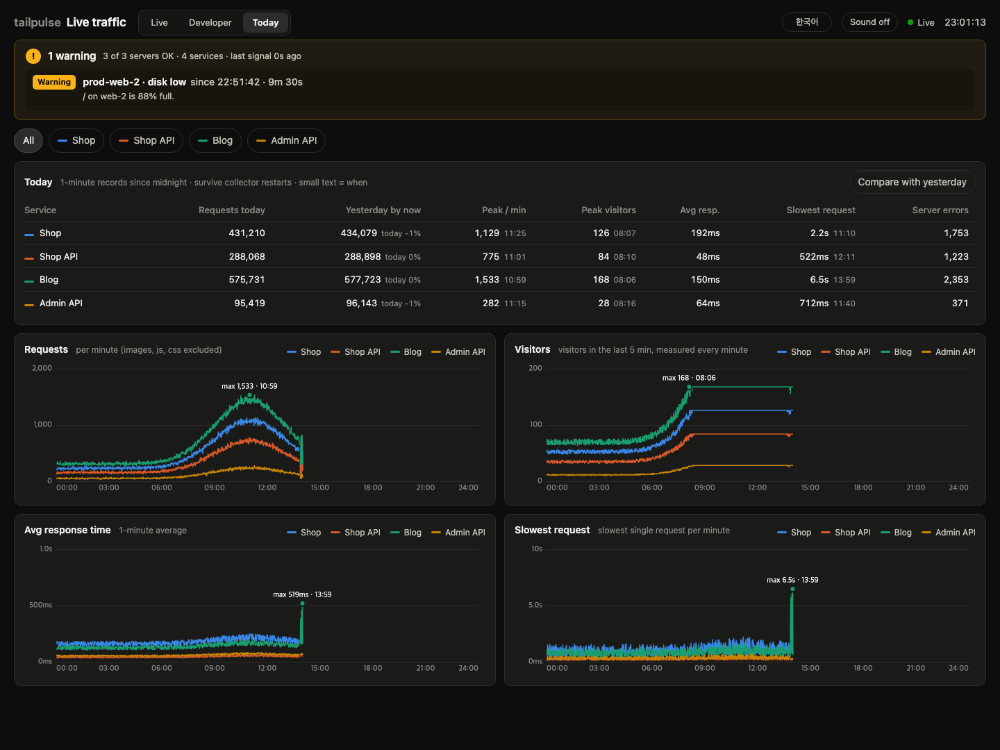

# tailpulse

**A tiny, self-hosted, real-time traffic monitor that reads your web server access logs.**
No SDK, no code changes, no database, no SaaS. One Python file per server, one jar for the dashboard.

[한국어 README](README.ko.md)



- **Is my site up right now?** Every server's agent sends a heartbeat every 10 s. A silent server turns the top bar red within 2 minutes and tells you which services lose capacity.
- **How much traffic, how fast, how many errors?** Requests per second, visitors, response times and 5xx rate per service, updated every second (Server-Sent Events).
- **What exactly is slow?** Every single request as a dot, the latest requests, slow requests and errors, and a per-path table.
- **Is today normal?** 1-minute history for today with yesterday overlaid, kept for 7 days.
- **Slack alerts** for servers that stop reporting, 5xx spikes, traffic that suddenly stops, full disks and high memory.
- **Privacy by design:** query strings are dropped, numeric IDs and tokens in paths are masked, IP addresses never leave the server (visitors are counted by a salted, daily-rotating hash).
- Dashboard in **English and Korean** (button at the top right, or `?lang=en` / `?lang=ko`).

## Who is it for?

Small teams that run a handful of servers (PHP, Java/Kotlin, Node, anything behind nginx or Apache) and want an "is everything OK?" screen and alerts **today**, without adopting a full APM, installing language agents, or sending traffic data to a third party. It is especially handy for old servers you'd rather not touch: the agent runs on Python 3.6 with only the standard library and never modifies the web server or the app.

### Compared with a commercial APM

| | tailpulse | Commercial APM (Datadog, New Relic, …) |
|---|---|---|
| Setup | Copy one Python file + config, change the log format, `docker compose up` | Language agent / SDK per app, often code or startup changes |
| Where data goes | Your own server only | Vendor cloud |
| Cost | Free (MIT) | Per host / per GB |
| Old stacks (PHP 5, Python 3.6 hosts) | Works, it only reads logs | Often unsupported |
| Latency of the view | ~1 s | Usually 10 s–1 min |
| Distributed tracing, DB query timings, stack traces | **No** | Yes |
| Real user monitoring, logs search, dashboards builder | **No** | Yes |
| High availability, long-term storage | **No** (see limits) | Yes |

### Limits (by design)

- **Single instance.** One collector process holds everything; no clustering, no HA. If it stops, monitoring stops (use the [watchdog](#watch-the-watcher)).
- **Per-request data lives in memory only** — the last 30 minutes, up to 200,000 requests per service. A restart clears it.
- **No database.** Only 1-minute aggregates (counts, response-time sum/max, visitor count) are written to small JSONL files and kept for 7 days.
- Only what is in the access log: method, path, status, response time. Nothing about what happens inside the app.
- Agents read `/proc` for CPU/memory, so the agent targets Linux. Alerts go to Slack incoming webhooks only. The dashboard uses one shared password (HTTP Basic).
- Up to 30 services per collector.

## How it works

```
 each server                                        collector server (one jar)                    browser
┌───────────────────────────┐                     ┌──────────────────────────────┐            ┌──────────────┐
│ nginx / apache access log │                     │ tailpulse (Spring Boot)      │            │ dashboard    │
│            │ tail         │  POST /ingest       │  · last 30 min in memory     │  SSE       │ (plain       │
│            ▼              │  X-Tailpulse-Token  │  · 1-min aggregates → files  │ /api/stream│  HTML/JS/CSS)│
│ tailpulse_agent.py ───────┼────────────────────▶│  · alerts → Slack            ├───────────▶│ every second │
│ (heartbeat every 10 s,    │  JSON batches       │                              │            │              │
│  CPU / memory / disk)     │                     └──────────────────────────────┘            └──────────────┘
└───────────────────────────┘
```

1. The **agent** follows the access log (handles logrotate: rename and copytruncate), turns each line into a small event, masks the path and hashes the visitor, and posts batches to `/ingest` with the `X-Tailpulse-Token` header. When there are no requests it still sends an empty batch every 10 s — that is the heartbeat — plus CPU, memory and disk usage.
2. The **collector** keeps the last 30 minutes in memory, computes per-second stats, writes a 1-minute aggregate line per service, and evaluates alerts.
3. The **dashboard** loads a snapshot, then receives one update per second over Server-Sent Events.

## Quick start (demo)

Requires Docker.

```sh
git clone https://github.com/chonghg22/tailpulse.git
cd tailpulse
docker compose up --build
```

Open <http://localhost:8080>. The demo starts the collector with four sample services on three servers, writes yesterday's and today's history so the **Today** tab is filled, and sends fake traffic. Things to try:

- `DEMO_DOWN=web-2 docker compose up` — one web server "dies": after 2 minutes the top bar turns red and shows that web-1 still serves the shop.
- The **Developer** tab: hover the dots, sort the per-path table.
- `docker compose down -v` removes the demo data.

Without Docker (JDK 21 and Python 3): `./dev demo`.

| Developer tab | Today tab |
|---|---|
|  |  |

## Run it for real

### 1. Start the collector

Pick a server that every agent can reach (a private address is best). Generate a token and, if the dashboard is reachable from outside, a password:

```sh
openssl rand -hex 32   # ingest token: agents send it, the collector checks it
openssl rand -hex 16   # dashboard password
```

**With Docker**

```sh
mkdir -p config && cp deploy/application.example.yaml config/application.yaml   # edit services and hosts
cp deploy/tailpulse.env.example tailpulse.env && chmod 600 tailpulse.env         # fill in token and password
docker compose -f deploy/docker-compose.prod.yml up -d --build
```

**Without Docker** (Java 21): `./gradlew bootJar` builds `build/libs/tailpulse.jar`. Install it with [`deploy/systemd/tailpulse.service`](deploy/systemd/tailpulse.service) (the steps are at the top of that file). Spring Boot reads `config/application.yaml` from the working directory.

Check it: `curl http://<collector>:8080/healthz` → `{"ok":true,"status":"UP"}`.

### 2. Install the agent on each server

Requirements: Linux with systemd, Python 3.6 or newer (standard library only), read access to the access logs.

Copy these files to a directory on the server:

```
agent/tailpulse_agent.py
agent/tailpulse-agent.service
agent/install-agent.sh
config.json          # from agent/config.example.json
token                # a file with the ingest token on one line
```

Then:

```sh
sudo bash install-agent.sh install config.json token
# no "adm" group on your distro (RHEL, Amazon Linux)? pass the group that can read the logs:
sudo bash install-agent.sh install config.json token --group nginx
```

The installer creates a `tailpulse` system account, copies the files to `/usr/local/lib/tailpulse-agent` and `/etc/tailpulse-agent` (token: mode 600), **runs `--check` as that account first** and only starts the service if the log lines parse. It restarts only `tailpulse-agent`, never your web server. The unit is limited to 80 MB of memory and 10 % CPU. Run the same command again to update.

```sh
sudo bash install-agent.sh status      # state, versions, memory
sudo bash install-agent.sh check       # parse rate of the last 200 lines, nothing is sent
sudo bash install-agent.sh uninstall
python3 tailpulse_agent.py --config config.json --dry-run   # print what would be sent
```

`--check` shows how many of the last 200 lines match, how many would be sent, how many were skipped (health checks etc.), how many have a response time and how many distinct visitors. Set `TAILPULSE_LANG=ko` for Korean output.

> Add a server to `hosts` in the collector config **after** its agent is connected — otherwise you get a "never reported" alert right away.

### Agent configuration

```json
{
  "collector": "http://192.0.2.10:8080/ingest",
  "token_file": "/etc/tailpulse-agent/token",
  "host": "web-1",
  "disks": ["/", "/data"],
  "sources": [
    { "service": "shop-web", "path": "/var/log/nginx/access.log", "format": "timed", "rt_unit": "s" },
    { "service": "shop-api", "path": "/var/log/nginx/api.access.log", "format": "timed", "rt_unit": "s",
      "exclude_path": "^/actuator/" }
  ],
  "alive": [ { "service": "ws", "url": "http://127.0.0.1:3000/" } ]
}
```

| Key | Meaning |
|---|---|
| `collector` | URL of the collector's `/ingest` |
| `token_file` | File with the ingest token |
| `host` | Server name shown in the dashboard (`[a-z0-9_-]`, ≤ 40). Default: the hostname |
| `disks` | Mount points to report usage for. Default `["/"]` |
| `sources[].service` | Service name; must match `services[].name` on the collector |
| `sources[].path` | Log file. May contain `strftime` patterns (`/logs/access.%Y-%m-%d.log`) for logs that change name daily; `path_tz_offset_hours` shifts the date (e.g. `9` when the server clock is UTC but file names use UTC+9) |
| `sources[].format` | `combined`, `combined_rt`, `timed` (recommended), `json` — see below |
| `sources[].rt_unit` | Unit of the response time in the log: `s` (nginx), `us` (apache `%D`), `ms` |
| `sources[].regex` | Your own regex instead of a format. Named groups: `ip`, `xff`, `ua`, `method`, `path`, `status`, `rt` (+ any you use in `require`) |
| `sources[].json_keys` | For `json`: field names, e.g. `{"path": "uri", "rt": "duration"}` |
| `sources[].require` | Only lines whose group matches, e.g. `{"vhost": "^www\\.example\\.com$"}` or `{"path": "^/admin(/\|$)"}` |
| `sources[].exclude_path` | Drop these paths (regex on the masked path), e.g. `^/cron$`, `^/actuator/` |
| `alive[]` | Services without an access log, see below |

Always skipped: `HEAD` and `OPTIONS`, load-balancer health checks (`ELB-HealthChecker`), `Blackbox Exporter`, and tailpulse's own probes.

### Web server log format

The plain `combined` format works (requests, visitors, errors), but you get **no response times**. Append two fields — the response time and `X-Forwarded-For` — and use `"format": "timed"`. Only a reload is needed, and the start of each line stays `combined`, so other log tools keep working.

**nginx** (`http {}` block):

```nginx
log_format tailpulse '$remote_addr - $remote_user [$time_local] "$request" '
                     '$status $body_bytes_sent "$http_referer" "$http_user_agent" '
                     'rt=$request_time xff="$http_x_forwarded_for"';
access_log /var/log/nginx/access.log tailpulse;
```

→ agent: `"format": "timed", "rt_unit": "s"`, then `sudo nginx -t && sudo nginx -s reload`.

**Apache** (`conf-available/tailpulse.conf`, `a2enconf tailpulse`):

```apache
LogFormat "%h %l %u %t \"%r\" %>s %b \"%{Referer}i\" \"%{User-Agent}i\" rt=%D xff=\"%{X-Forwarded-For}i\"" tailpulse
CustomLog ${APACHE_LOG_DIR}/access.log tailpulse
```

→ agent: `"format": "timed", "rt_unit": "us"` (`%D` is microseconds), then `sudo apachectl -t && sudo systemctl reload apache2`.

| `format` | Log line | Response time |
|---|---|---|
| `combined` | nginx/Apache default | — |
| `combined_rt` | combined + the response time as the last field | yes |
| `timed` | combined + `rt=… xff="…"` (above) | yes |
| `json` | one JSON object per line (defaults: `remote_addr`, `request_method`, `request_uri`, `status`, `request_time`, `http_user_agent`, `http_x_forwarded_for`) | yes |

**Behind a load balancer or proxy**, `$remote_addr` is the proxy, so every request would look like the same visitor. With `xff` in the log, the agent takes the **right-most address that is not private** from `X-Forwarded-For` (the left-most part can be forged by the browser). If a CDN with public addresses sits in front, configure nginx `real_ip` (or Apache `mod_remoteip`) so `$remote_addr` is the real client instead.

### Services without an access log (`alive`)

For a WebSocket server, a worker with a health endpoint, or any app that writes no access log:

```json
"alive": [ { "service": "ws", "url": "http://127.0.0.1:3000/", "timeout_sec": 3 } ]
```

Every 10 s the agent calls the URL **on the same server**. Any answer below 500 within the timeout counts as alive (a 404 still means the app answered), and only then is a heartbeat sent. When it stops answering, heartbeats stop and the server shows as down in the dashboard and in Slack. `sources` may be empty.

## Collector configuration

Environment variables (secrets) — see [`deploy/tailpulse.env.example`](deploy/tailpulse.env.example):

| Variable | Default | Meaning |
|---|---|---|
| `TAILPULSE_INGEST_TOKEN` | *(empty)* | Token agents must send. **Empty = every `/ingest` is rejected** |
| `TAILPULSE_VIEW_PASSWORD` | *(empty)* | Dashboard and API password (HTTP Basic, any user name). Empty = no login: only for localhost or a private network |
| `TAILPULSE_SLACK_WEBHOOK_FILE` | *(empty)* | File containing the Slack incoming-webhook URL. Empty = no Slack alerts (the dashboard still shows them) |
| `TAILPULSE_LANG` | `en` | Language of Slack alerts: `en` or `ko` |
| `TAILPULSE_ZONE` | server time zone | Where a day starts for the Today tab, e.g. `Asia/Seoul` |
| `TAILPULSE_DATA_DIR` | `data` | Folder for the 1-minute files (`trend/trend-YYYY-MM-DD.jsonl`) |
| `TAILPULSE_PORT` | `8080` | HTTP port |

`config/application.yaml` — see [`deploy/application.example.yaml`](deploy/application.example.yaml):

```yaml
tailpulse:
  services:
    - name: shop-web                   # = "service" sent by the agent
      label: Shop                      # shown in the dashboard
      kind: PHP                        # free text badge
      url: https://shop.example.com    # shown in front of paths (never called)
      health-url: https://shop.example.com/   # optional: called every 10 s; 5xx, timeout (5 s) or refused = down
      hosts: [web-1, web-2]            # optional: alert even if one of these never reports
  host-info:                           # agent host → friendly name and role on cards and alerts
    web-1: { name: "prod-web-1", role: "Shop web #1" }
```

Services that agents report but that are not listed still show up (with their raw name).

### Alerts

The same rules drive the red/yellow bar at the top of the dashboard and the Slack messages. Each problem is sent once, and a recovery message is sent once when it clears.

| Alert | Rule (default) | Setting |
|---|---|---|
| Agent silent | No heartbeat for 120 s (servers in `hosts` also when they never reported) | `agent-silent-seconds` |
| Server error spike | Last minute: ≥ 10 errors **and** ≥ 20 % 5xx | `error-surge-count`, `error-surge-percent` |
| Traffic stopped | ≥ 20 requests/min during the previous 10 min, then 0 for 3 min (server up, site down) | `silence-min-per-minute` |
| Disk | ≥ 85 % warning, ≥ 95 % critical | `disk-warn-percent`, `disk-critical-percent` |
| Memory | ≥ 90 % for more than 10 minutes | `memory-warn-percent` |
| Site not responding | `health-url` failing for 60 s | `health-down-seconds` |

Test the Slack connection: `curl -u x:<password> -X POST http://localhost:8080/api/alert-test`.

The dashboard's **Sound** button adds a beep and a browser notification for new critical issues (per browser).

### Endpoints

| | |
|---|---|
| `POST /ingest` | Agent batches (token header; ≤ 2,000 events per batch) |
| `GET /api/snapshot` | Current state and the last 10 minutes |
| `GET /api/stream` | Server-Sent Events, one `tick` per second |
| `GET /api/trend?date=YYYY-MM-DD` | 1-minute aggregates of a day (default: today) |
| `POST /api/alert-test` | Send a test Slack message |
| `GET /healthz` | `{"status":"UP"}`, no password |

## Security and privacy

**What an agent sends** per request: time, response time, status code, method, path (masked), a visitor hash, and a static-file flag. Per batch: service, host name, and every 10 s CPU / memory / disk usage and load.

**What is never sent or stored:** IP addresses, User-Agent strings, query strings, request or response bodies, cookies, headers, and unmasked IDs or tokens in paths.

- Paths: the query string (`?…`) and fragment are removed; purely numeric segments become `:n`; segments that look like tokens (≥ 20 URL-safe characters, or ≥ 16 hex characters) become `:token`; paths are cut to 120 characters. Review your paths with `--dry-run` — the masking is a heuristic. Use `exclude_path` for anything sensitive it doesn't catch (e.g. e-mail addresses in paths).
- Visitors: `sha256(token + date + IP + User-Agent)`, first 16 hex characters. It changes every day, so visitors can't be followed across days. This is **pseudonymous, not anonymous**: someone who knows the token could test guesses, so keep the token secret.
- On the collector, per-request events (masked path, hash) exist **only in memory for 30 minutes**. Files contain only per-minute counts, response-time sums/maxima and visitor counts — no paths, no hashes — and are deleted after 7 days.

**Recommendations**

- Open the collector's `/ingest` port **only to your agent servers' IP addresses** (security group / firewall). Best: agents post to the collector's private address. If some servers can only reach it over the internet, expose `/ingest` through the reverse proxy and allow just those IPs — see [`deploy/nginx-tailpulse.conf`](deploy/nginx-tailpulse.conf).
- Put the dashboard behind HTTPS (the example above), set `TAILPULSE_VIEW_PASSWORD`, and optionally restrict it to your office/VPN. The example also rate-limits password guessing.
- Keep `tailpulse.env`, the token file and the webhook file at mode 600. The webhook URL is never written to logs.
- The demo profile uses a public token (`demo-token`) and binds to `127.0.0.1` — never expose it.

## Watch the watcher

If tailpulse dies, its alerts die with it. [`deploy/watchdog/tailpulse-watchdog.sh`](deploy/watchdog/tailpulse-watchdog.sh) runs on **another** server (cron, every minute), checks `/healthz`, posts to Slack after 3 failures in a row and once more when it recovers. Run a tailpulse agent on that server too, and the two watch each other.

```sh
echo 'https://hooks.slack.com/services/...' > webhook && chmod 600 webhook
sudo bash tailpulse-watchdog.sh install --url https://monitor.example.com/healthz --webhook-file webhook [--fails 3] [--lang en|ko]
rm webhook
sudo tailpulse-watchdog status          # state and recent log (/var/log/tailpulse-watchdog.log)
# try without Slack:
DRY_RUN=1 URL=http://127.0.0.1:1/healthz STATE_DIR=/tmp/wd CONF_DIR=/tmp/wd bash tailpulse-watchdog.sh
```

Needs `bash`, `curl` and `python3`. The webhook URL goes to curl through stdin, so it never appears in `ps` or logs.

## Development

```sh
./gradlew test                                  # collector (Kotlin, JUnit)
python3 -m unittest discover -s agent/tests     # agent (also run on Python 3.6 in CI)
./dev demo                                      # collector + fake traffic, http://localhost:8080
```

- Collector: Kotlin, Spring Boot, Java 21 (`src/main/kotlin`). Dashboard: plain HTML/JS/CSS with no libraries or CDN (`src/main/resources/static`). UI strings live in the `I18N` table at the top of `app.js`.
- The agent must stay a single file using only the Python 3.6 standard library, must only read logs, and must drop data silently when the collector is unreachable rather than affect the server.

## License

[MIT](LICENSE)
